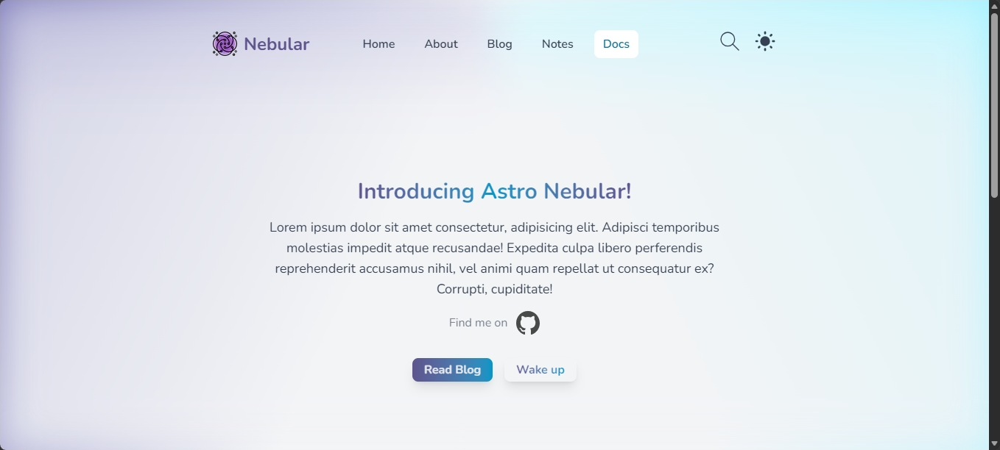
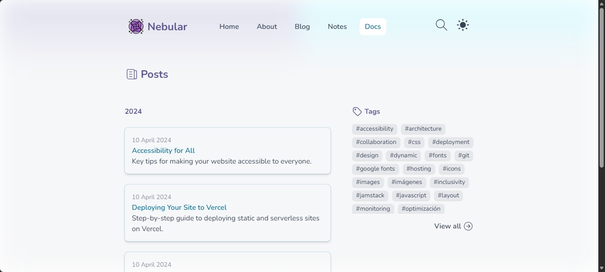
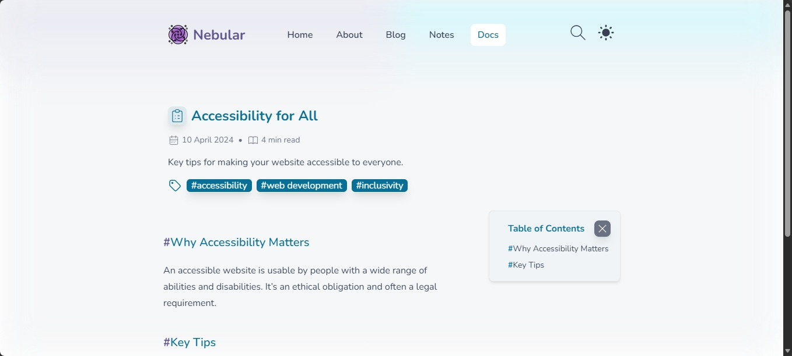
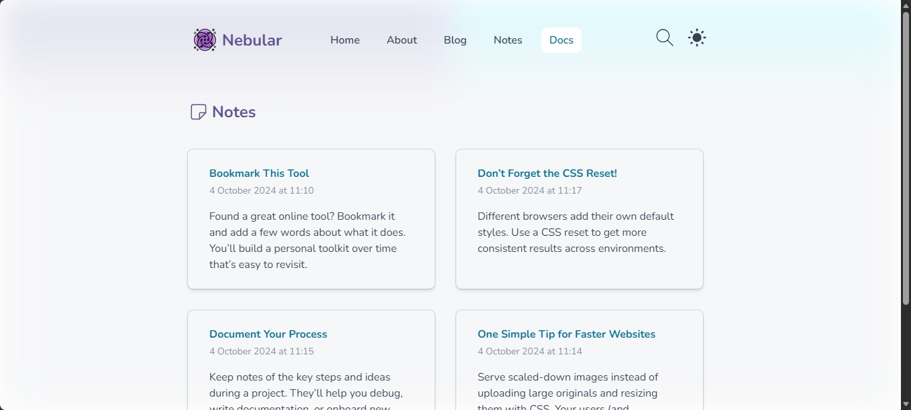
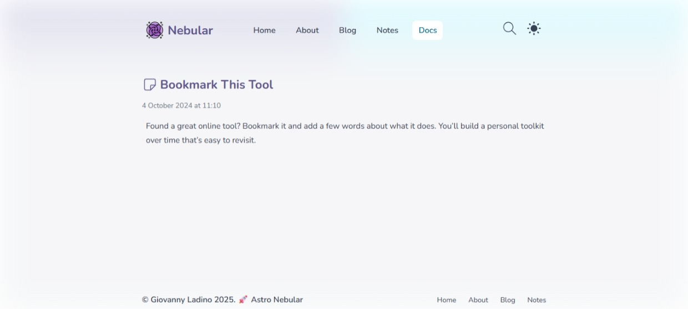
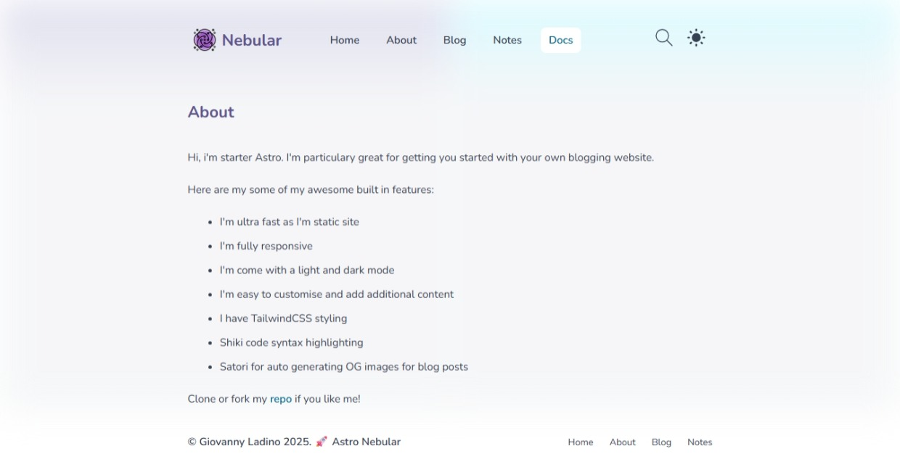

# 🌌 Nebular

**Nebular** es un blog informativo moderno y minimalista desarrollado con **Astro** y **TailwindCSS**, enfocado en ofrecer una experiencia de lectura rápida, limpia y adaptable a diferentes dispositivos.

🔗 **Demo:** https://nebular-blog.vercel.app/

---

## ✨ Características

- Diseño responsive y adaptable a dispositivos móviles.
- Interfaz minimalista enfocada en la lectura.
- Estructura de contenido orientada a formato editorial.
- Generación de páginas estáticas para mejorar el rendimiento.
- Estilos tipográficos optimizados para contenido extenso.
- Despliegue mediante Vercel.

---

## 🛠️ Tecnologías

| Tecnología | Uso |
|---|---|
| [Astro](https://astro.build/) | Framework principal y generación de páginas |
| [TailwindCSS](https://tailwindcss.com/) | Estilos y diseño responsive |
| [Tailwind Typography](https://github.com/tailwindlabs/tailwindcss-typography) | Estilos para contenido editorial |
| [Vercel](https://vercel.com/) | Despliegue y hosting |

---

## 📸 Vista previa













---

## 🚀 Instalación

### 1. Clonar el repositorio

```bash
git clone https://github.com/GiovannyLG21/Nebular.git
cd Nebular
```

### 2. Instalar dependencias

```bash
npm install
```

### 3. Iniciar el servidor de desarrollo

```bash
npm run dev
```

El proyecto estará disponible en:

```bash
http://localhost:4321
```

---

## 📦 Build de producción

Para generar la versión optimizada para producción:

```bash
npm run build
```

Para previsualizar el build localmente:

```bash
npm run preview
```

---

## 📁 Estructura del proyecto

```bash
Nebular/
├── public/          # Recursos estáticos
├── src/
│   ├── components/  # Componentes reutilizables
│   ├── layouts/     # Layouts de las páginas
│   ├── pages/       # Rutas y páginas
│   └── ...
├── astro.config.mjs
├── package.json
└── README.md
```

--- 

## 👨‍💻 Autor

Giovanny Ladino

- GitHub: https://github.com/GiovannyLG21
- Demo: https://nebular-blog.vercel.app/

---

## 📄 Licencia

Este proyecto está publicado bajo la licencia MIT.